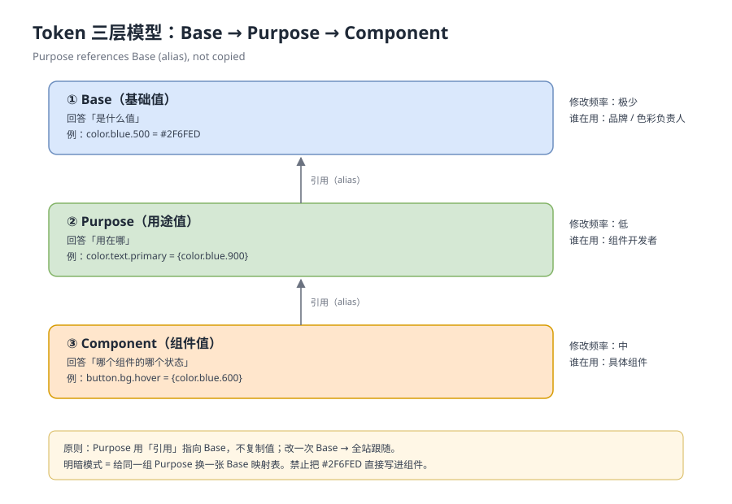
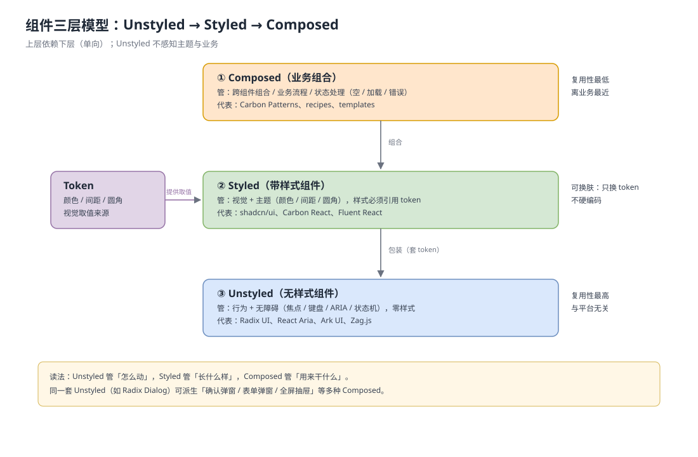
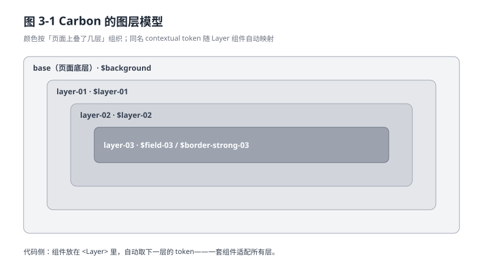
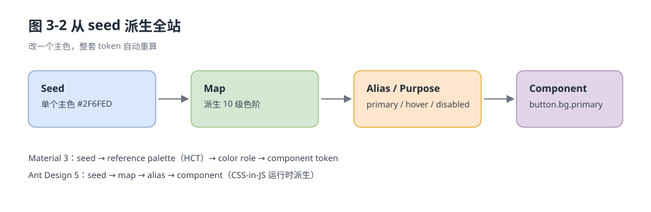
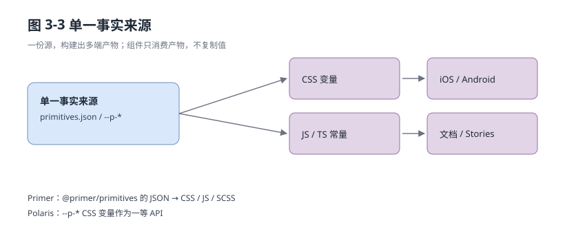
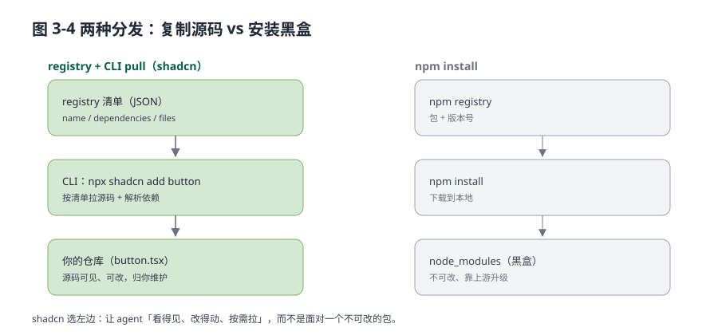

# 设计系统资产分层维护与 Agentic 结合调研报告

> **范围**：React / Web 端 · 设计工具 Figma · 关注「日常分层维护方式」与「SDLC harness 中资产管理」的 agentic 结合
> **日期**：2026-11-12
> **证据分级**：A = 官方文档/规范原文 · B = 官方博客/发布说明 · C = 社区与二手资料 · D = 基于既有公开知识的推断

---

## 摘要

1. **业界已经收敛出一套通用的「三层」分层范式**：Token 分 **Base → Purpose → Component** 三层；组件分 **Unstyled → Styled → Composed** 三层。几乎所有主流设计系统都能映射到这个框架上，差异在于「单一事实来源（SSOT）放在哪一层」。
2. **token 的交换格式刚刚标准化**：W3C DTCG《Design Tokens Format Module》于 2025-10-28 发布 Final Community Group Report，规范标记为 **stable**，`.tokens` / `.tokens.json` 成为推荐文件扩展名。这是「设计系统资产可被机器（包括 AI agent）稳定消费」的关键里程碑。
3. **Agentic 结合已从营销话术进入可用阶段**：Figma、Carbon、Storybook、shadcn/ui 均已提供**官方 MCP 服务器**；shadcn 的 **registry + CLI 按需拉取**是当前最「agent-friendly」的组件分发模式；Figma 的 **Code Connect** 把「设计组件 ↔ 代码组件」的映射固化下来供 agent 复用。
4. **对你的结论**：在 SDLC harness 里管理设计系统资产，应把设计系统组织成一个 **「可被 agent 消费的代码仓库」**，以 DTCG token JSON + 组件清单（manifest）+ MCP/技能文件为契约，而不是只停留在 Figma 或只打包成 npm。

---

## 1. 调研范围与方法

- **研究对象**（长名单）：Carbon(IBM)、Material 3(Google)、Fluent 2(Microsoft)、Ant Design 5、Polaris(Shopify)、Primer(GitHub)、MUI、shadcn/ui、React Aria / Spectrum(Adobe)。
- **观察切面**：① token 分层；② 组件分层；③ 分发机制；④ 版本与治理（日常维护）；⑤ Figma 协同方式；⑥ agentic 就绪度（官方 MCP / registry / 机器可读契约）。
- **方法**：以官方文档与规范原文为准（证据 A），辅以官方发布说明与博客（证据 B），交叉验证二手资料（证据 C）。

---

## 2. 核心概念：分层模型

### Token 三层



| 层级 | 命名特征 | 例子 | 谁在使用 | 修改频率 |
|---|---|---|---|---|
| **Base（基础值）** | 描述「是什么」，不带用途 | `color.blue.500`、`palette.primary.40` | 品牌/色彩负责人 | 极少（品牌变更才动） |
| **Purpose（用途值）** | 描述「用在哪」，引用 Base | `color.bg.default`、`color.text.primary` | 组件开发者 | 低频（主题/明暗切换） |
| **Component（组件值）** | 描述「哪个组件的哪个状态」 | `button.bg.hover`、`input.border.focus` | 具体组件 | 中频 |

> 关键原则：**Purpose 通过「别名/引用（alias）」指向 Base，而不是复制值**。这样改一处 Base，Purpose 自动跟随；明暗模式只是给同一组 Purpose 换一张 Base 映射表。DTCG 规范把「别名引用」固化为 `{token.path}` 与 JSON Pointer 两种语法。

### 组件三层



| 层级 | 职责 | 代表 |
|---|---|---|
| **Unstyled（无样式组件）** | 行为 + 可访问性 + 状态机，不含样式 | Radix UI、React Aria、Ark UI、Zag |
| **Styled（带样式组件）** | 套上 token 与视觉样式 | shadcn/ui、Carbon React、Fluent React |
| **Composed（业务组合）** | 跨组件的组合方案（表单、空状态、数据表） | Carbon Patterns、各 DS 的 Recipes |

> **对 agent 的意义**：Unstyled 把「交互逻辑 + a11y」从「视觉」里剥离，视觉完全交给 token。agent 生成代码时，行为层直接复用（不重写无障碍逻辑），视觉层只需替换 token 即可换肤——**一致性从机制上得到保证，而不是靠 agent 自觉**。

---

## 3. 主流设计系统的典型模型

九套系统的形态差异很大，但归纳起来主要是四种模型。各挑最具代表性的：

### 3.1 分层治理型：Carbon
把 token 按「页面叠了几层」组织（base / layer-01~03 + contextual token），再配完整治理（生命周期、迁移指南、官方 MCP `code_audit`）。是「分层 + 治理」做得最完整的一家。



几个关键点：

- **每层是一整套 token**：`$layer-0N`（背景）、`$field-0(N+1)`（控件底）、`$border-0N`（边框）配套使用。
- **跨层按 +1 取号**：输入框放在 layer-01 上，用的是 `$field-02`，不是 `$field-01`。
- **层与层是同一把梯子的相邻台阶**：共享色阶、按步长递进，但每个值独立设计。
- **混用会「看不见」**：在 layer-02 上用 `$field-01`，输入框会和背景糊在一起。

> 一句话：不是「外层给内层传 token」，而是「每深一层，换一套 token」——背景变了，控件必须换一档才能保持对比度。

### 3.2 算法派生型：Material 3 / Ant Design 5
只给一个种子色，色板、语义、组件 token 全部自动派生：M3 走 seed→role→component，AntD 走 seed→map→alias→component。好处是「改一处全站重算」，代价是 token 不是静态文件。



### 3.3 单一事实源型：Primer
用一份 JSON（`@primer/primitives`）作唯一源，构建出 CSS / JS / SCSS 多端产物。所有消费方只认这一个源，不复制值。



### 3.4 源码分发型：shadcn/ui
组件不是 npm 包，而是源码文件：registry 清单 + CLI 按需拉取，CLI 3.0 起自带 MCP。是目前最 agent-ready 的一套。



---

## 4. 能给 agent 分发的设计资产

能分发的分两类：**设计系统本身**，和**承载设计系统的工具**。

### 4.1 能分发的四家

| 系统 / 工具 | 类型 | 给 agent 的分发方式 | agent 拿到什么 |
|---|---|---|---|
| **Carbon** | 设计系统 | 官方 MCP（远程 / 本地） | `code_audit` / `code_search` / `docs_search` / `get_charts` / `labs_search` + 可读 token 常量 |
| **shadcn/ui** | 设计系统 | registry + CLI + MCP | 组件源码（拉进仓库）+ CSS 变量 |
| **Figma** | 设计工具 | 官方 MCP（远程 / 桌面）+ Code Connect | variables / components / 布局；Code Connect 把设计组件映射到真实代码组件 |
| **Storybook** | 文档工具 | MCP addon | 组件 API（`componentsManifest`）+ 可跑测试（`test-run`） |

> 其余七家没进表：
> - **Fluent 2 / Primer / Polaris / Spectrum**：有可读的 token 包，但**没有 agent 接口**，要自建适配。
> - **Material 3 / Ant Design 5 / MUI**：token 在运行时主题里，**agent 拿不到静态文件**。
>
> 注意：**Figma / Storybook 本身不是设计系统**，而是「设计系统所在的地方」——它们分发的其实是你们的设计资产。

### 4.2 分发用的 token / 文件体系

不管用哪家的原料，建议按下面 5 类文件组织，让 agent「按需打开」：

```
design-system/
├── AGENTS.md                    # ① 规则（agent 启动必读）
├── manifest.json                # ② 清单（入口）
├── tokens/
│   ├── base.tokens.json         # ③ Base 层
│   ├── purpose.tokens.json      # ③ Purpose 层（带 $description）
│   └── component.tokens.json    # ③ Component 层
├── components/
│   ├── button/
│   │   ├── button.tsx           # ④ 源码
│   │   └── button.md            # ④ 说明书
│   └── dialog/
│       ├── dialog.tsx
│       └── dialog.md
├── patterns/
│   └── login-form.md            # ⑤ 业务组合
└── skills/
    └── build-ui/SKILL.md        # ⑤ 技能（可选）
```

**① `AGENTS.md`：规则**

```md
# 设计系统使用规则
- 颜色、间距只能引用 tokens/purpose.tokens.json
- 组件只能用 components/*/*.md 里列出的 variant
- 禁止阅读 tokens/base.tokens.json
- 生成代码后跑 `npm run audit`
```

**② `manifest.json`：清单**

```json
{
  "version": "1.0.0",
  "tokens": ["base", "purpose", "component"],
  "components": [
    { "name": "button", "path": "components/button", "doc": "button.md" },
    { "name": "dialog", "path": "components/dialog", "doc": "dialog.md" }
  ],
  "patterns": ["login-form"],
  "skills": ["build-ui"]
}
```

**③ Token 三层分文件**

```json
// tokens/purpose.tokens.json
{
  "color": {
    "text": {
      "primary": {
        "$type": "color",
        "$value": "{color.gray.900}",
        "$description": "正文主色，用于段落与标题"
      }
    },
    "action": {
      "primary": {
        "$type": "color",
        "$value": "{color.blue.600}",
        "$description": "主操作按钮背景色（提交 / 确认）"
      }
    }
  }
}
```

**④ 组件：源码 + 说明书**

```md
<!-- components/button/button.md -->
---
name: Button
layer: styled
---

## 何时用
单个、明确的动作（提交、确认、取消）

## Props
| prop | 类型 | 说明 |
|---|---|---|
| variant | primary \| secondary | 主 / 次操作 |
| type | button \| submit | 原生类型 |
```

**⑤ 组合与技能**

```md
<!-- patterns/login-form.md -->
---
name: LoginForm
layer: composed
---
## 组成：TextField × 2 + Button（primary / submit）
```

```md
<!-- skills/build-ui/SKILL.md -->
---
name: build-ui
description: 生成符合公司设计系统的 React UI；涉及页面或组件时使用
---
1. 先读 manifest.json
2. 读对应组件的 .md
3. 颜色 / 间距引用 purpose.tokens.json
```

### 4.3 文件与 MCP 的关系

| | 文件方式 | MCP 方式 |
|---|---|---|
| 适合 | agent 直接读仓库（Copilot / Claude Code） | agent 调工具（查询、校验） |
| 入口 | `manifest.json` | `tools/list` |
| 校验 | `npm run audit` | `code_audit` 工具 |

两种可以共存：**文件给「读」，MCP 给「查和校验」**。

---

## 5. Agentic / SDLC harness 结合：现状与模式

### 5.1 标准化机器可读契约（DTCG 2025.10）

[Design Tokens Format Module 2025.10](https://www.w3.org/community/reports/design-tokens/CG-FINAL-format-20251028/) 已作为 Final Community Group Report 发布，**标记 stable**。要点：

- 文件即 JSON，推荐扩展名 `.tokens` / `.tokens.json`，MIME `application/design-tokens+json`。
- 核心属性：`$value`（必需）、`$type`、`$description`、`$deprecated`、`$extensions`。
- **Groups** 支持 `$type` 继承、`$extends`（等价 JSON Schema `$ref`）、`$root` 根 token。
- **别名/引用** 支持 `{token.path}` 与 JSON Pointer 两种语法，`$deprecated` 可携带「迁移到哪个 token」的提示。

> 对 SDLC harness 的意义：**DTCG JSON 就是「设计系统资产」与「agent」之间的标准契约**。`$description` 可给 agent 当注释用，`$deprecated` 可让 agent 自动避开旧 token，`$type` 让 agent 知道该如何取值。这比任何私有格式都更适合放进 harness 的资产层。

### 5.2 MCP 服务器（agent 直接读设计系统）

| MCP | 提供方 | 能力 | 证据 |
|---|---|---|---|
| **Figma MCP** | Figma（官方） | 提取 variables/components/布局上下文、由帧生成代码、**Code Connect 复用真实组件**、写回画布、Figma Specs | [官方指南](https://help.figma.com/hc/en-us/articles/32132100833559-Guide-to-the-Figma-MCP-server)（A） |
| **Carbon MCP** | IBM（官方） | 检索组件/token 文档，含「token conservation」策略 | Carbon 官网（A） |
| **Storybook MCP** | Storybook（官方） | 把 Stories 作为设计系统上下文注入 agent | [官方博客](https://storybook.js.org/blog/storybook-mcp-for-react/)（B） |
| **shadcn MCP** | shadcn（官方） | registry 检索与组件落地 | 更新日志（B） |

> Figma MCP 的 **Code Connect** 特别值得注意：它把「设计里的组件」显式映射到「代码里的组件」，agent 生成代码时**优先复用已存在的真实组件**，而不是重写一遍。这正是 harness 资产管理想要的「资产即约束」。

### 5.3 registry / CLI 按需分发（shadcn 模式）

传统 npm 整包分发对 agent 不友好（大而全、不可见、难改）。shadcn 的 **registry + CLI pull** 让「组件 = 一段你拥有的源码」，agent 拉取即落地。这个模式已被广泛复制，也是「设计系统作为资产」最自然的形态。

### 5.4 Unstyled 组件 + 结构化文档

Radix / React Aria 把「行为 + a11y」做成可复用的 Unstyled 层，视觉交给 token。对 agent 而言：**行为层直接 import，不重写；视觉层替换 token，不硬编码**。配合 Storybook（Stories 即文档）与 MCP，agent 能「看到」组件长什么样、有哪些 props、如何组合。

### 5.5 现状小结

- **已经真实可用**：Figma MCP（含 Code Connect）、Carbon MCP、Storybook MCP、shadcn MCP + registry、DTCG 稳定规范。
- **仍是营销/半成品**：多数「设计系统 + AI」的 PPT 话术、无官方 MCP 的第三方 D2C 工具。
- **判断标准**：是否提供「机器可读契约 + 官方 MCP/API + 可复现的复用路径」，三者缺一即应降级看待。

---

## 6. 落地建议：SDLC harness 中设计系统资产的推荐结构

把设计系统组织成 **「DS-as-Repo」（可被 agent 消费的仓库）**，而非「Figma 文件 + npm 包」两张皮。

### 6.1 资产目录结构（推荐）

```
design-system/
├── tokens/                      # 机器可读契约（SSOT）
│   ├── base.tokens.json         # Base（基础值）层
│   ├── purpose.tokens.json      # Purpose（用途值）层（引用 Base）
│   └── component.tokens.json    # component 层
├── components/                  # Unstyled + Styled
│   ├── primitives/              # 基于 Radix/React Aria 的 Unstyled 封装
│   └── ui/                      # 主题化组件（shadcn 式，属你所有）
├── patterns/                    # 组合模式
├── stories/                     # 每个组件的 Stories（文档 + agent 上下文）
├── manifest.json                # 资产清单：组件/token/图标索引（给 agent 检索）
├── skills/ 或 AGENTS.md         # 给 agent 的规则：「用这些 token、复用这些组件」
└── figma/                       # Code Connect 映射 + Variables 同步脚本
```

### 6.2 Agent 消费契约（三层）

1. **Token 契约**：DTCG `.tokens.json`，agent 读 `$description` 选 token、读 `$deprecated` 避坑。
2. **组件契约**：`manifest.json` 列出「组件名 → 路径 → props → 何时用」，配合 Storybook MCP 让 agent 复用而非重写。
3. **规则契约**：`AGENTS.md` / skills 写明「禁止硬编码颜色/间距，必须引用 token；优先复用 `components/ui`」。

### 6.3 日常维护工作流（三方同步）

```
Figma Variables ──(Tokens Studio/原生同步)──▶ tokens/*.tokens.json
                                                    │
                              Style Dictionary 构建 ▼
                     CSS 变量 / JS 常量（组件消费）
                                                    │
         Chromatic 视觉回归 + Storybook 文档 ◀──────┘
                                                    │
         agent（MCP + manifest + skills）直接读 tokens 与 stories
```

- 每次 token 变更走 semver + changelog + 迁移说明（`$deprecated` 写清替代项）。
- 视觉回归（Chromatic）守住「改 token 不破坏组件」。

### 6.4 分阶段路线

1. **第一周**：把现有 token 收敛成 DTCG JSON，跑通 Style Dictionary 产出 CSS 变量。
2. **第二周**：组件目录建立 manifest + AGENTS.md，接入 Storybook（或直接 Storybook MCP）。
3. **第三周**：选 Figma MCP（+ Code Connect）打通设计侧；在 harness 里验证「agent 生成的表单/表格是否命中 token、是否复用组件」。
4. **验证指标**：token 命中率、组件复用率、一次通过率、硬编码样式出现次数。

---

## 7. 风险与待验证假设

- **DTCG 刚 stable，工具链兼容不一**：Style Dictionary v4 已「forward-compatible」，但 Figma Variables 导出仍需 Tokens Studio 或手工映射，需实测。
- **官方 MCP 的能力边界**：Figma 写回画布是远程付费能力（beta 后 usage-based），Code Connect 需逐组件配置，落地成本要评估。
- **Unstyled 路线的前期成本**：Radix/React Aria 自建主题层有工作量，但换来 agent 复用率与 a11y 保障，需按团队规模权衡。
- **「能否分发给 agent」缺少统一评测**：本报告用「契约 + MCP + 复用路径」作判断标准，建议你用自己的 PoC（6.4 节第 3 周）验证后再定论。

---

## 8. 附录：主要来源

- [Design Tokens Format Module 2025.10（W3C DTCG，Final Report）](https://www.w3.org/community/reports/design-tokens/CG-FINAL-format-20251028/)
- [Carbon Design System — Color Guidelines（分层模型）](https://www.carbondesignsystem.com/building-blocks/foundations/color/guidelines)
- [Carbon MCP](https://www.carbondesignsystem.com/getting-started/carbon-mcp/overview)
- [Style Dictionary（DTCG 支持）](https://styledictionary.com/)
- [Guide to the Figma MCP server（官方）](https://help.figma.com/hc/en-us/articles/32132100833559-Guide-to-the-Figma-MCP-server)
- [Storybook MCP for React（官方博客）](https://storybook.js.org/blog/storybook-mcp-for-react/)
- [shadcn/ui 2025-08 更新日志（CLI 3.0 + MCP）](https://ui.shadcn.org.cn/docs/changelog/2025-08-cli-3-mcp)
- [Material Design 3 — Design tokens](https://m3.material.io/foundations/design-tokens/overview)
- [Ant Design 5.0 发布（token 算法）](https://cloud.tencent.cn/developer/article/2216283)
- [Tokens Studio — Git 同步](https://github.com/tokens-studio/tokens-studio-for-figma-plugin-docs/blob/main/token-storage/remote/sync-git-github.md)

> 注：本报告为方法论 + 事实盘点的「第一阶段」交付，Fluent/Polaris/Primer/MUI 的细节主要基于公开官方文档的既有知识（证据 A/B），如需我把每一行的出处逐条核到具体 URL 并补充下载量/star 等定量数据，可继续执行第二阶段。
